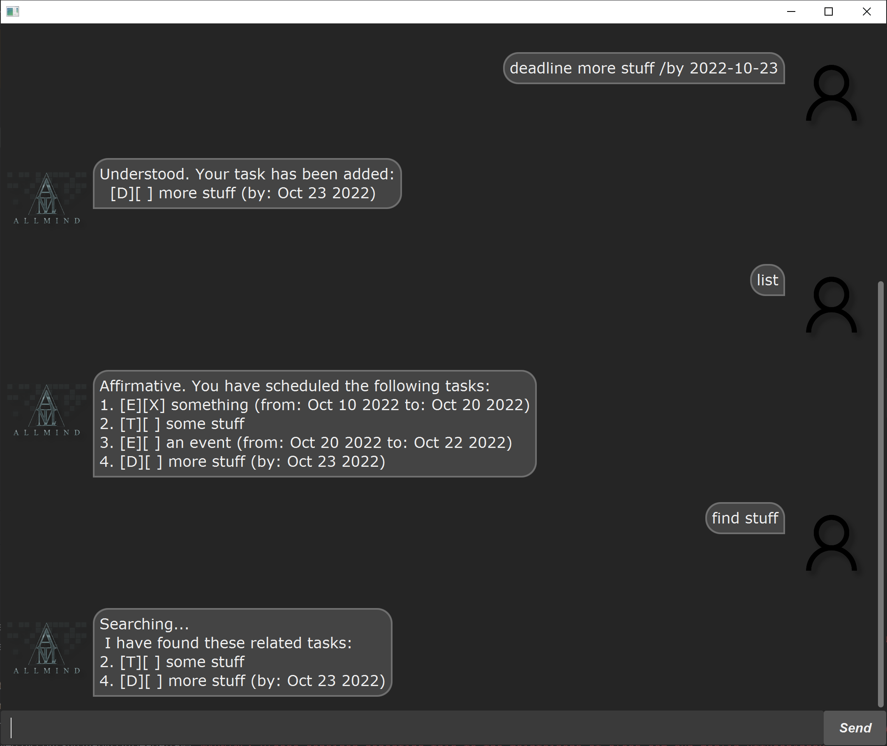

# AllMind User Guide

AllMind is a lightweight task manager for keeping track of todos, deadlines,
and events. Tasks are saved automatically, so they are available the next time
you start AllMind.



## Getting started

Enter one command at a time. Use `bye` to exit AllMind.

## Adding tasks

### Todos

Use `todo` followed by a task description:

```text
todo read lecture notes
```

### Deadlines

Use `deadline`, a description, and a date in `yyyy-mm-dd` format:

```text
deadline submit report /by 2026-10-20
```

### Events

Use `event`, a description, and the event's start and end dates:

```text
event team meeting /from 2026-10-21 /to 2026-10-22
```

All dates must use the `yyyy-mm-dd` format.

## Finding tasks

Use `find` followed by a keyword to search task descriptions. The search is
case-insensitive and returns every task whose description contains the keyword.

```text
find report
```

For example, this can find both `submit report` and `review report`.
AllMind requires a keyword after `find`.

## Detecting event clashes

When you add an event, AllMind checks whether its date range overlaps with an
unfinished event already in your task list. If a clash is found, AllMind shows
the conflicting events and the overlapping dates, then asks whether you still
want to add the new event:

```text
This event clashes with:
1. team meeting (Oct 21 2026 to Oct 22 2026)
Are you sure you want to add this event? (yes/no)
```

Enter `yes` to add the event or `no` to discard it. Completed events do not
trigger clash warnings.

## Managing tasks

### Listing tasks

```text
list
```

Displays all tasks with their list numbers.

### Marking a task as done

```text
mark 2
```

Marks task 2 as completed.

### Marking a task as not done

```text
unmark 2
```

Marks task 2 as incomplete again.

### Deleting a task

```text
delete 2
```

Deletes task 2 from the list.

## Command summary

| Command | Format | Purpose |
| --- | --- | --- |
| Add todo | `todo DESCRIPTION` | Adds a todo task |
| Add deadline | `deadline DESCRIPTION /by DATE` | Adds a task with a deadline |
| Add event | `event DESCRIPTION /from DATE /to DATE` | Adds an event and checks for clashes |
| Find tasks | `find KEYWORD` | Searches task descriptions |
| List tasks | `list` | Shows all tasks |
| Mark done | `mark NUMBER` | Completes a task |
| Unmark done | `unmark NUMBER` | Reopens a task |
| Delete task | `delete NUMBER` | Removes a task |
| Exit | `bye` | Exits AllMind |

## Acknowledgements

ChatGPT and Codex was used to refactor and code in this project.

